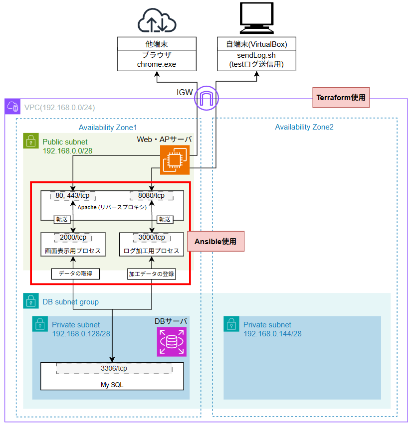

# AWS Server Configuration & Application Deployment (Ansible)

Terraformで構築したAWS上のEC2サーバーに対し、Go言語製のアプリケーション（ログ加工用プロセス、Web画面表示用プロセス）のデプロイ、起動、およびApacheリバースプロキシの設定を行うAnsibleプレイブックです。

## 📁 ディレクトリ構成
```text
.
├── inventory.ini         # 接続先サーバーのIPやSSH鍵の設定
├── playbook.yml          # 実行するプレイブックの定義
└── roles/
    └── apache/
        ├── files/        # Apacheの設定ファイル
        ├── handlers/     # FW、Apache再起動
        └── tasks/        # Apacheのインストール、設定ファイルの置き換え、Apacheの実行など
    └── binary/
        ├── files/        # デプロイするアプリケーションバイナリ等
        ├── tasks/        # ファイルコピー、権限付与、バックグラウンド起動のタスク
        └── vars/         # 変数定義（デプロイ先パスなど）
```

## 🚀 デプロイ手順
1. 接続情報の確認
inventory.ini に対象のEC2インスタンスのIPアドレス、SSH秘密鍵のパス、ユーザー名が正しく設定されていることを確認します。

2. 変数の設定
必要に応じて roles/binary/vars/main.yml やタスク内のDB接続情報（DB_DSN）を確認・設定します。

3. プレイブックの実行
```bash
ansible-playbook -i inventory.ini playbook.yml
```

## 🌐 アーキテクチャ概要
